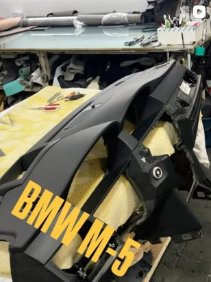

# Auto Interiore – Website & Werkstatt-Admin (Pitch-Demo)



**Live:** https://demos.coach-raffael.com/car-interior/ (nicht gelistet, Start beim Öffnen) – ausgerollt über den Showcase-Hub, siehe `demo.yaml`.

Proaktive Demo für [@autointeriore](https://www.instagram.com/autointeriore/), eine Sattlerei in Tbilisi, die Armaturenbretter (ტორპედო) und Lenkräder mit Leder neu bezieht.

Alle Daten sind Beispieldaten und liegen im Browser (localStorage). Nichts wird verschickt oder gepostet.

## Starten

```bash
npm install
npm run dev      # http://localhost:5173
npm run build    # statischer Build in dist/ (läuft auf jedem Static Host)
```

## Öffentliche Website (`/`)

- **Leder-Konfigurator** im Hero: Leder (6 Farben), Oberfläche (Nappa/Alcantara/Perforiert), Faden und Einfach-/Doppelnaht live auf einem gezeichneten Armaturenbrett. Die Naht wird bei jeder Änderung neu „genäht“.
- **Arbeiten**: Galerie nach Marke filterbar.
- **Teile nach Modell**: Splash-Auswahl Marke → Modell → verfügbare Teile, die man in die Anfrage legen kann.
- **Auftrags-Funnel**: 5 Schritte (Auto, Arbeit + gewählter Look + Teile, Fotos, Termin, Kontakt) mit grober Preisschätzung. Blockierte Tage aus dem Admin-Kalender sind gesperrt. Danach geht es optional per WhatsApp weiter.
- Sprachen: **Georgisch** (Standard), Englisch, Russisch.

## Admin (`/#/admin`)

| Bereich | Funktion |
|---|---|
| Overview | Neue Anfragen, Tagesplan, Werkstatt-Pipeline, offene Punkte |
| Orders | Kanban (Drag & Drop) von Anfrage bis Übergabe; Detail mit Look, Fotos, Termin buchen, WhatsApp-Antwort |
| Calendar | Monatsansicht, Termine, Lieferungen, Blocktage |
| Calculator | Material + Stunden + Marge + 18 % MwSt → Angebot; speichert ins Auftragsdetail, erzeugt Bestellung |
| Purchase orders | Bestellungen an Lieferanten per E-Mail/WhatsApp, Status bis Wareneingang |
| Suppliers & dealers | Lieferanten, Teilehändler, Partner-Werkstätten |
| Parts shop | Bestand, Preis, Sichtbarkeit auf der Website |
| Social content | Post-Entwürfe in KA/EN/RU, Freigabe, Metricool-Payload |

Details zur Social-Pipeline: [docs/content-pipeline.md](docs/content-pipeline.md)

## Vor einem echten Einsatz

- Galeriebilder sind Ausschnitte aus seinem Instagram-Grid (mit Text-Overlays) → durch Originalfotos ersetzen.
- Georgische und russische Texte von Muttersprachlern prüfen lassen.
- Preise im Konfigurator, Funnel und Kalkulator sind Platzhalter.
- Logo: aktuell Wortmarke; sein Monogramm-Logo als SVG einsetzen.
- Backend (Supabase o. ä.) für Aufträge, Login fürs Admin, Bild-Upload, Metricool-Versand.

## Backend und MCP (optional)

Mit `VITE_API_URL` läuft Website und Admin gegen das Backend in `server/` (PostgreSQL, Login, Bild-Upload) statt gegen localStorage. Das Backend bringt einen **MCP-Server mit OAuth** mit: Claude kann als Custom Connector Galerie, Teile, Aufträge, Kalender, Bestellungen und Social Posts bedienen – mit Freigaben pro Tool (ALLOW / APPROVAL / DENY) im Admin unter **Approvals** und **AI access**. Details, Tool-Liste und Betrieb: [server/README.md](server/README.md). Produktiv-Stack: `docker-compose.yml` + `Caddyfile`.

Ohne `VITE_API_URL` bleibt alles wie bisher: eine in sich geschlossene Browser-Demo.

## Showcase-Hub

- `demo.yaml` – Demo-Vertrag (Slug `car-interior`, nicht gelistet, schläft nach 60 min)
- `Dockerfile` – statischer Build unter `BASE_PATH`, ausgeliefert von static-web-server (ohne OS-Pakete, kein Root, Port 8080)
- `.github/workflows/showcase.yml` – Qualitätsgate (`npm test`, oxlint + tsc, Secrets-, Abhängigkeits- und Image-Scan) und Meldung an den Hub
- `e2e/` – Playwright-Kernablauf (Buchung) für das Erlebnis-Gate; `npm test` – Vitest für Preise und Konfigurator

## Stack

Vite · React 19 · TypeScript · Tailwind CSS 4 · Zustand · React Router (Hash) · Lucide · Vitest · Playwright · static-web-server
